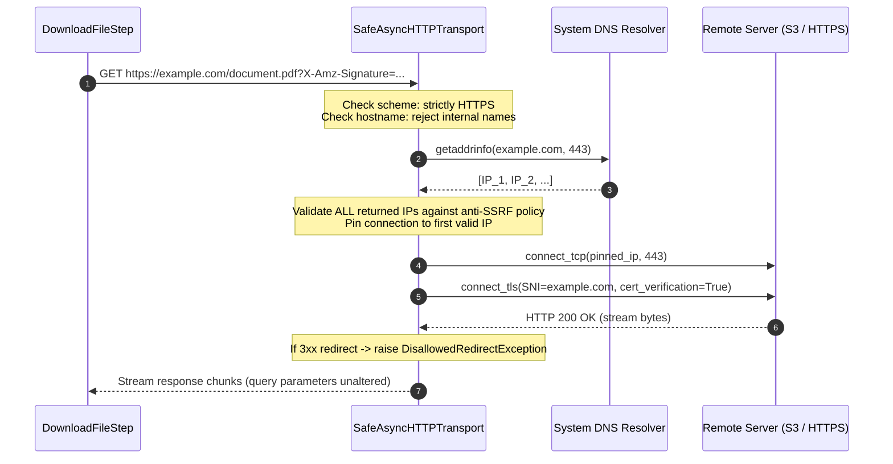

# Security Architecture: File Confinement & Anti-SSRF Network Protection

**Initiative**: #151 - Security Hardening
**Tracking Plan**: S1 | **Priority**: P0
**Associated Design Decision**: D1
**GitHub Reference**: `Closes #152`

---

## 1. Executive Summary

This document describes the security controls introduced to protect Document IA against:
- **Server-Side Request Forgery (SSRF - OWASP A10:2021)** and **DNS Rebinding (TOCTOU)** during remote document ingestion (`file_url`).
- **Path Traversal & Arbitrary File Overwrite (OWASP A01:2021)** caused by untrusted HTTP `Content-Disposition` headers or URL paths.
- **Filesystem Sandbox Escapes & Symlink Traversal** on worker container nodes.

These hardening measures strictly isolate file manipulation and network retrieval without breaking backwards compatibility or altering signed AWS S3 / MinIO presigned URL requests.

---

## 2. Threat Model & Mitigations

| Threat Vector | OWASP Ref | Vulnerability Mechanism | Implemented Defense |
| :--- | :--- | :--- | :--- |
| **SSRF - Loopback Access** | A10:2021 | Client supplies `https://127.0.0.1` or `https://localhost` to scan worker local services. | Multi-tier address blocking in `IPValidator` intercepting all loopback ranges (`127.0.0.0/8`, `::1`). |
| **SSRF - Private Network Pivoting** | A10:2021 | Client supplies private IPs (`10.0.0.0/8`, `172.16.0.0/12`, `192.168.0.0/16`, CGNAT `100.64.0.0/10`) to pivot to PostgreSQL or Redis. | Pre-connection IP filtering rejecting any non-globally-routable unicast address. |
| **SSRF - Cloud Metadata Exfiltration** | A10:2021 | Attacker accesses `http://169.254.169.254` (AWS/Scalingo) or `http://metadata.google.internal` (GCP) to steal IAM credentials. | Blocklist includes link-local (`169.254.0.0/16`, `fe80::/10`) and cloud metadata hostnames. |
| **DNS Rebinding (TOCTOU)** | A10:2021 | Attacker domain returns a benign public IP during initial check, then resolves to `127.0.0.1` upon HTTP connection. | **Socket Pinning** in `SafeAsyncHTTPTransport`: DNS is resolved upfront, all returned IPs must be valid, and the TCP socket connects directly to the validated IP. |
| **Redirect SSRF Bypass** | A10:2021 | Public URL responds with HTTP `302 Found` redirecting to an internal endpoint. | Strict redirect prohibition (`follow_redirects=False`). HTTP `3xx` raises `DisallowedRedirectException`. |
| **Filename Path Traversal** | A01:2021 | Malicious `Content-Disposition: attachment; filename="../../etc/cron.d/evil"` or `https://attacker.com/../../etc/shadow`. | Worker completely ignores `Content-Disposition` and URL paths; generates random `uuid4().hex` filenames with verified MIME extensions. |
| **Sandbox Escape / Symlink Attack** | A01:2021 | Attacker crafts symlink inside the workspace pointing to `/etc/hosts` to read or delete host files upon cleanup. | Bottom-up walk with `followlinks=False` removes the symlink itself without touching or traversing target files. All paths verified with `.resolve().is_relative_to(sandbox)`. |

---

## 3. Network Architecture (Anti-SSRF & Socket Pinning)

### 3.1 IP Address Validation (`IPValidator`)

`document_ia_infra.core.network.ip_validator` inspects each resolved IP address (both IPv4 and IPv6) against a comprehensive set of forbidden CIDR blocks:
- **IPv4 Loopback**: `127.0.0.0/8`
- **IPv4 Private (RFC 1918)**: `10.0.0.0/8`, `172.16.0.0/12`, `192.168.0.0/16`
- **IPv4 Link-Local / Cloud Metadata (RFC 3927)**: `169.254.0.0/16`
- **IPv4 CGNAT (RFC 6598)**: `100.64.0.0/10`
- **IPv4 Multicast & Broadcast**: `224.0.0.0/4`, `255.255.255.255/32`, `0.0.0.0/8`
- **IPv6 Loopback & Unspecified**: `::1/128`, `::/128`
- **IPv6 Unique Local (ULA - RFC 4193)**: `fc00::/7` (includes AWS IPv6 metadata `fd00:ec2::254`)
- **IPv6 Link-Local**: `fe80::/10`
- **IPv4-Mapped IPv6**: Addresses formatted like `::ffff:127.0.0.1` are unmapped and validated against IPv4 rules.

### 3.2 Safe Async Transport Flow



### 3.3 Presigned URL Signature Preservation

Presigned URLs (such as AWS S3 `X-Amz-Signature`, Google Cloud Storage, or Azure SAS tokens) are cryptographically signed using the raw query string and path. Normalizing or re-encoding query parameters causes signature mismatches (`SignatureDoesNotMatch`).

`SafeAsyncHTTPTransport` transmits the raw request URL unaltered. The socket pinning occurs strictly at the TCP socket layer (`connect_tcp(pinned_ip, port)`), preserving the exact query string, path, and HTTP headers (`Host: <hostname>`).

---

## 4. Filesystem Confinement (`SafePath`)

### 4.1 Execution Sandbox

Each workflow execution is confined to a private directory keyed by its validated UUIDv4:
```
/tmp/document_ia_worker.tmp/<execution_id>/
├── <random_uuid4>.tmp         # In-flight download buffer
├── <random_uuid4>.pdf         # Verified final file
└── preprocess/                # Subfolder for rasterized pages
    └── page_001.png
```

### 4.2 Path Validation Invariants

Before any file write, rename, replace, or delete:
1. `validate_execution_id(execution_id)`: Asserts `execution_id` is a valid UUID, preventing directory traversal injection (`../../etc`).
2. `validate_safe_path(target, sandbox_root)`: Canonicalizes the target using `.resolve()` and asserts `target.is_relative_to(sandbox_root)`. Any escape raises `PathTraversalException`.
3. `safe_cleanup_directory(directory, sandbox_root)`: Performs bottom-up recursive deletion using `os.walk(followlinks=False)`. Symlinks located inside the sandbox are unlinked directly; external files pointed to by symlinks are **never traversed or modified**.

---

## 5. Verification & Testing Matrix

The implementation is verified by the unit test suite located at:
[`document-ia-worker/tests/unit/workflow/step/test_download_file_security.py`](file:///Users/nsagon/Projects/beta/documentAI/document-ia/document-ia-worker/tests/unit/workflow/step/test_download_file_security.py)

| Test Case | Injected Payload | Expected Defense Behavior |
| :--- | :--- | :--- |
| `test_ssrf_loopback_blocked` | `https://127.0.0.1`, `https://localhost`, `https://[::1]` | `BlockedAddressException` raised before connection. |
| `test_ssrf_rfc1918_and_cgnat_blocked` | `https://10.0.0.1`, `https://172.16.0.1`, `https://192.168.1.1`, `https://100.64.0.1` | `BlockedAddressException` raised. |
| `test_ssrf_cloud_metadata_blocked` | `https://169.254.169.254`, `https://metadata.google.internal` | `BlockedAddressException` raised. |
| `test_ssrf_ipv6_mapped_and_link_local_blocked` | `https://[::ffff:127.0.0.1]`, `https://[fe80::1]` | `BlockedAddressException` raised. |
| `test_strict_https_protocol_enforcement` | `http://...`, `ftp://...`, `file:///etc/passwd` | `InvalidProtocolException` raised. |
| `test_dns_rebinding_simulation` | DNS returning public IP + `127.0.0.1` | `BlockedAddressException` raised (all addresses must be safe). |
| `test_disallowed_redirect_blocked` | Server returns HTTP 302 to metadata endpoint | `DisallowedRedirectException` raised. |
| `test_content_disposition_injection_ignored` | `Content-Disposition: attachment; filename="../../etc/shadow"` | Header ignored, file named `<uuid4>.pdf`. |
| `test_path_traversal_subfolder_rejected` | Subfolder set to `../../etc` | `PathTraversalException` raised. |
| `test_invalid_execution_id_rejected` | Execution ID set to `../../escaping_id` | `InvalidUUIDException` raised. |
| `test_symlink_escape_cleanup_safe` | Symlink inside sandbox pointing to outside file | Symlink unlinked; external file untouched. |
| `test_file_size_limit_exceeded` | Binary payload > 25 MB | Download aborted; temp buffer unlinked. |
| `test_invalid_mime_type_rejected_early` | Shell script disguised as PDF | Rejected on first 2KB chunk via `magic`. |
| `test_presigned_url_query_parameters_preserved` | Signed AWS S3 query parameters | S3 signature query string preserved bit-for-bit. |

---

## 6. Environment Configuration

The security policies are enabled and strictly enforced by default. The following optional settings are exposed via `document_ia_infra.core.file.file_settings.FileSettings`:

| Setting | Env Alias | Default | Description |
| :--- | :--- | :--- | :--- |
| `MAX_FILE_SIZE` | `MAX_FILE_SIZE` | `26214400` (25MB) | Maximum file size in bytes accepted by worker downloads. |
| `ALLOW_INSECURE_HTTP` | `FILE_ALLOW_INSECURE_HTTP` | `False` | **Testing/Dev only**. When `True`, permits plaintext `http://` URLs. |
| `ALLOW_LOCAL_NETWORK` | `FILE_ALLOW_LOCAL_NETWORK` | `False` | **Testing/Dev only**. When `True`, permits loopback IP addresses (`127.0.0.1`, `::1`). |
