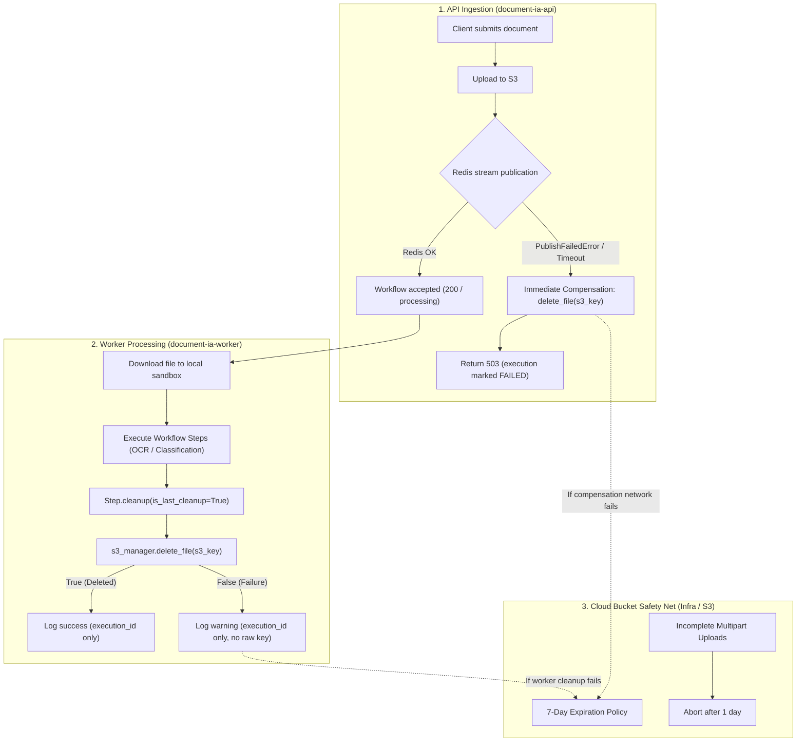

# Architecture & Security: S3 Object Storage Retention & Lifecycle Management

**Initiative**: #151 - Security Hardening
**Tracking Plan**: S6 | **Priority**: P1
**Associated Design Decision**: D2
**GitHub Reference**: `Closes #157`

---

## 1. Executive Summary

Document IA processes highly sensitive identity and administrative documents (e.g., pay slips, national identity cards, residence permits). These documents are temporarily stored in AWS/Outscale-compatible S3 buckets during asynchronous ingestion and dispatch.

This document details the multi-layered retention and deletion architecture designed to guarantee that:
1. **No orphaned document lingers on object storage** when API ingestion or workflow scheduling fails.
2. **Workers acknowledge deletion failures reliably** without misleading logs.
3. **Sensitive file keys are strictly protected from leakage** into application logs.
4. **Cloud buckets enforce an immutable safety-net lifecycle policy** covering active objects and incomplete multipart uploads.

---

## 2. Threat Model & Mitigations

| Threat Vector | OWASP / RGPD Ref | Vulnerability Mechanism | Implemented Defense |
| :--- | :--- | :--- | :--- |
| **Sensitive Data Lingering (GDPR)** | GDPR Art. 5(1)(e) (Storage limitation) | Uploaded files remain stored indefinitely if a worker crashes before cleanup. | Cloud-level 7-day expiration lifecycle policy acts as an unconditional safety net. |
| **Orphaned Files on Scheduling Failure** | OWASP A04:2021 (Insecure Design) | When API uploads file to S3 but Redis queue publication fails (#147), document remains on S3. | Immediate compensating deletion in API services (`WorkflowService` and `WorkflowV2Service`). |
| **Silent Deletion Failure (False Negative)** | OWASP A09:2021 (Logging Failures) | `S3Manager.delete_file` returns `False` on failure, but worker logs "deleted successfully". | Worker explicitly inspects the return code; logs a structured warning/error on failure. |
| **Sensitive Key Leakage in Logs** | OWASP A09:2021 (Security Logging) | Logging raw S3 keys containing customer metadata or file identifiers. | Strict prohibition of raw `s3_key` in logs; worker logs only execution IDs. |
| **Incomplete Multipart Upload Accumulation** | Cost & Storage Exhaustion | Failed multipart uploads leave behind unreferenced chunks that accumulate silently. | Lifecycle policy rule configured to abort incomplete multipart uploads after 1 day. |

---

## 3. Storage Lifecycle Architecture



---

## 4. Key Security Invariants

### 4.1 Immediate API Compensation
When a file is uploaded to S3, but subsequent processing cannot be guaranteed (e.g. database failure during `emit_workflow_started`, Redis publication failure `PublishFailedError`, or idempotency reservation loss `IdempotencyReservationLostException`):
- The API service catches the exception.
- The uploaded S3 object is immediately deleted via `s3_service.delete_file(s3_key)`.
- The exception is then propagated to return the appropriate HTTP error (e.g. 503 Service Unavailable) without leaving unmanaged objects in storage.

### 4.2 Non-Disclosure of Sensitive S3 Keys in Logs
S3 keys may contain sensitive identifiers or file naming artifacts. In compliance with data protection policies:
- Workers **MUST NOT** include raw S3 keys in log messages (`logger.info`, `logger.error`, `logger.warning`).
- Log entries must only reference `execution_id`.

```python
# Compliant pattern in DownloadFileStep.cleanup:
deleted = s3_manager.delete_file(self.file_info.s3_key.get_secret_value())
if deleted:
    logger.info("S3 file deleted successfully for execution %s", self.execution_id)
else:
    logger.warning("Failed to delete S3 file for execution %s (safety-net will expire it)", self.execution_id)
```

### 4.3 S3 Lifecycle Configuration Specification
Cloud storage buckets (AWS S3 / Outscale Object Storage) are configured with the following lifecycle rules:

```xml
<LifecycleConfiguration>
    <Rule>
        <ID>DocumentExpirationSafetyNet</ID>
        <Status>Enabled</Status>
        <Filter>
            <Prefix></Prefix>
        </Filter>
        <Expiration>
            <Days>7</Days>
            <ExpiredObjectDeleteMarker>true</ExpiredObjectDeleteMarker>
        </Expiration>
        <NoncurrentVersionExpiration>
            <NoncurrentDays>7</NoncurrentDays>
        </NoncurrentVersionExpiration>
        <AbortIncompleteMultipartUpload>
            <DaysAfterInitiation>1</DaysAfterInitiation>
        </AbortIncompleteMultipartUpload>
    </Rule>
</LifecycleConfiguration>
```
