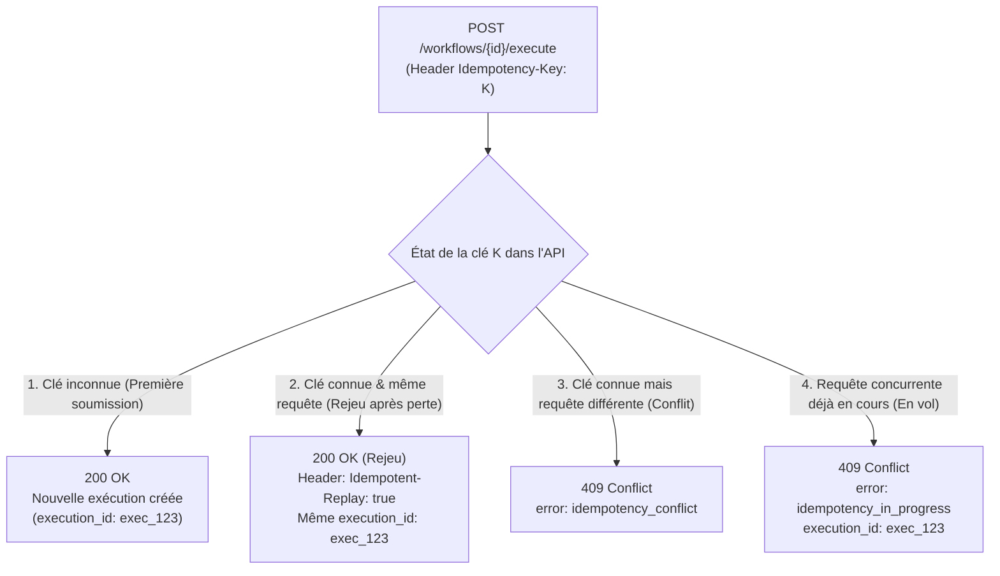

# Guide d'utilisation de l'en-tête `Idempotency-Key`

Ce guide explique comment utiliser l'en-tête HTTP `Idempotency-Key` lors de la soumission de workflows sur l'API Document IA afin de fiabiliser les intégrations et d'éviter les doubles exécutions en cas d'incident réseau.

---

## 1. Pourquoi utiliser `Idempotency-Key` ?

Dans une architecture distribuée, une requête réseau peut être interrompue **après** que l'API l'a reçue et programmée avec succès :
- Timeout côté client (ex. timeout HTTP fixé à 15 s alors que l'upload et l'admission prennent 16 s) ;
- Timeout intermédiaire (erreur `504 Gateway Timeout` émise par un reverse proxy ou ingress) ;
- Coupure TCP ou redémarrage impromptu du conteneur client.

Sans clé d'idempotence, un orchestrateur externe qui relance sa soumission crée une **seconde exécution distincte**, provoquant :
- Un double passage dans la chaîne de traitement lourde (téléversement S3, extraction OCR et inférences LLM facturées au token) ;
- Deux `execution_id` distincts pour un document administratif unique ;
- Des notifications webhooks contradictoires ou redondantes.

L'en-tête `Idempotency-Key` garantit que **renouveler une soumission après une incertitude réseau renvoie l'exécution originale sans déclencher de second traitement**.

---

## 2. Endpoints supportés

L'en-tête `Idempotency-Key` est pris en charge sur les routes asynchrones de production :

- `POST /api/v2/workflows/{workflow_id}/execute` *(recommandé)*
- `POST /api/v1/workflows/{workflow_id}/execute`

> [!NOTE]
> Les routes synchrones (`execute-sync`) sont réservées au débogage interactif et ne prennent pas en charge l'idempotence.

---

## 3. Format et validation de la clé

La valeur du header `Idempotency-Key` doit respecter les règles suivantes :
- **Longueur** : comprise entre **1 et 256 caractères** inclus.
- **Caractères autorisés** : caractères **ASCII imprimables uniquement** (codes décimaux `32` à `126`, c'est-à-dire lettres, chiffres, ponctuation et espaces standards).
- Les caractères accentués, les sauts de ligne (`\n`) ou les caractères de contrôle non imprimables sont strictement rejetés avec une erreur **`400 Bad Request`** (`error: invalid_idempotency_key`).

---

## 4. Comment calculer ou choisir la valeur de la clé ?

Trois approches sont recommandées selon l'architecture de votre système :

### Approche A : Identifiant métier unique (Recommandé)
Si votre système dispose déjà d'un identifiant stable pour la pièce ou l'action à exécuter, utilisez-le directement :
```text
Idempotency-Key: demarche-948271-piece-justificatif-domicile
```
*Avantage* : Même en cas de redémarrage complet de votre service, la clé reste prévisible et déterministe.

### Approche B : UUIDv4 de transaction
Générez un UUIDv4 au moment de décider l'envoi du document, enregistrez-le dans votre base de données locale ou votre message de queue, et réutilisez-le dans tous les retries :
```python
import uuid

# Généré une seule fois avant la première tentative
idempotency_key = str(uuid.uuid4())
```
*Avantage* : Aucune collision possible entre différentes actions.

### Approche C : Empreinte de hachage locale (SHA-256)
Si votre orchestrateur est sans état (*stateless*), vous pouvez dériver la clé à partir d'un hash cryptographique du contenu du fichier combiné à votre identifiant de dossier :
```python
import hashlib

hasher = hashlib.sha256()
hasher.update(file_bytes)
hasher.update(dossier_id.encode("utf-8"))
idempotency_key = f"hash-{hasher.hexdigest()}"
```

---

## 5. Fonctionnement et Cycle de Vie côté API

L'API calcule de manière autonome une **empreinte cryptographique (fingerprint SHA-256)** de votre requête combinant l'URL, la méthode, les paramètres (`override`, `metadata`) et le contenu du document (fichier ou `file_url`).

### Les 4 réponses possibles de l'API :



1. **Première soumission réussie (`200 OK`)** :
   L'exécution est programmée normalement. Le document est stocké sur S3 et le message envoyé au worker.

2. **Rejeu après coupure réseau (`200 OK` avec en-tête `Idempotent-Replay: true`)** :
   Si vous renvoyez la même requête avec la même clé :
   - L'API retrouve l'exécution d'origine.
   - Elle vous renvoie le payload `200 OK` d'admission avec le même `execution_id`.
   - L'en-tête HTTP `Idempotent-Replay: true` est ajouté dans la réponse.
   - **Aucun nouveau fichier n'est téléversé sur S3, aucun événement dupliqué en base, aucun message supplémentaire dans Redis.**

3. **Conflit d'empreinte (`409 Conflict`)** :
   Si vous réutilisez la même clé pour envoyer un fichier différent ou modifier les paramètres :
   ```json
   {
     "type": "about:blank",
     "title": "Conflict",
     "status": 409,
     "code": "http.conflict",
     "errors": {
       "error": "idempotency_conflict",
       "message": "The idempotency key is already used with a different request payload."
     }
   }
   ```

4. **Requête concurrente en vol (`409 Conflict`)** :
   Si deux requêtes avec la même clé arrivent à la même seconde (ex. timeout client agressif déclenchant un retry immédiat alors que le premier appel est encore en cours d'admission) :
   ```json
   {
     "type": "about:blank",
     "title": "Conflict",
     "status": 409,
     "code": "http.conflict",
     "errors": {
       "error": "idempotency_in_progress",
       "execution_id": "9b1deb4d-3b7d-4bad-9bdd-2b0d7b3dcb6d",
       "message": "An execution with this idempotency key is currently being processed. You can query its status using the provided execution_id."
     }
   }
   ```
   Vous recevez immédiatement l'`execution_id` pré-réservé, ce qui vous permet de consulter son statut via `GET /api/v1/executions/{execution_id}` sans bloquer votre processus.

---

## 6. Durée de conservation (TTL)

- La clé d'idempotence est conservée pendant **12 heures** (par défaut).
- Passé ce délai, la clé expire. Une requête envoyée avec cette clé après 12 heures sera considérée comme une toute nouvelle soumission.
- En cas d'incident technique temporaire empêchant la programmation (`503 Service Unavailable`), **la clé est immédiatement libérée** afin que votre retry puisse s'exécuter sans attendre l'expiration du verrou.

---

## 7. Exemples d'intégration

### Exemple en Python (`httpx` avec boucle de retry)

```python
import uuid
import httpx
from tenacity import retry, stop_after_attempt, wait_exponential, retry_if_exception_type

API_URL = "https://document-ia.etalab.gouv.fr/api/v2/workflows/document-extraction-v2/execute"
API_KEY = "<your-key>"

# Clé stable générée une seule fois pour l'opération
idempotency_key = f"demarche-piece-{uuid.uuid4()}"

@retry(
    stop=stop_after_attempt(4),
    wait=wait_exponential(multiplier=1, min=2, max=10),
    retry_error_callback=lambda state: state.outcome.result(),
)
def submit_document(file_path: str):
    headers = {
        "X-API-KEY": API_KEY,
        "Idempotency-Key": idempotency_key,
    }

    with open(file_path, "rb") as f:
        files = {"file": (file_path, f, "application/pdf")}
        data = {
            "metadata": '{"source": "mon_application"}',
            "override": '{"llm_extract_data": [{"param": "document_type", "value": "cni"}]}',
        }

        response = httpx.post(API_URL, headers=headers, files=files, data=data, timeout=30.0)

        # 200 OK (première soumission ou rejeu réussi)
        if response.status_code == 200:
            is_replay = response.headers.get("Idempotent-Replay") == "true"
            print(f"Succès (Rejeu={is_replay}) : execution_id = {response.json()['data']['execution_id']}")
            return response.json()

        # 409 Conflict si une requête concurrente est en vol
        if response.status_code == 409 and response.json().get("errors", {}).get("error") == "idempotency_in_progress":
            execution_id = response.json()["errors"]["execution_id"]
            print(f"Traitement déjà en cours : execution_id = {execution_id}")
            return {"execution_id": execution_id}

        response.raise_for_status()

submit_document("mon_document.pdf")
```

### Exemple en cURL

```bash
curl -X POST "https://document-ia.etalab.gouv.fr/api/v2/workflows/document-extraction-v2/execute" \
  -H "X-API-KEY: <your-key>" \
  -H "Idempotency-Key: doc-12345-justificatif" \
  -F "file=@/chemin/vers/document.pdf;type=application/pdf" \
  -F 'metadata={"dossier_id": "12345"}'
```
