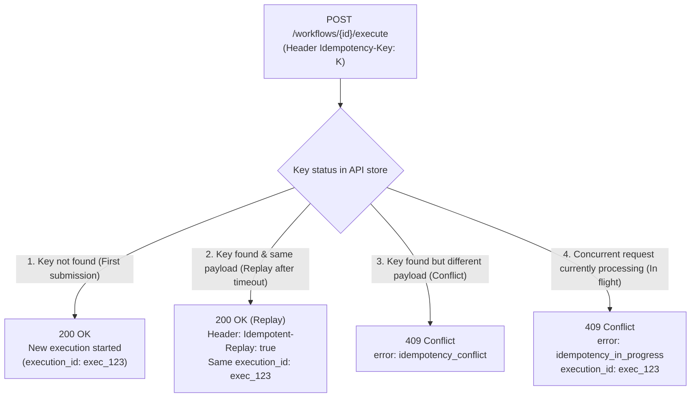

# Workflow `Idempotency-Key` Guide

This guide explains how to use the `Idempotency-Key` HTTP header when submitting document workflows to the Document IA API in order to ensure resilience and prevent duplicate executions caused by network failures.

---

## 1. Why use `Idempotency-Key`?

In a distributed architecture, network interruptions frequently occur **after** the API has successfully received, validated, and scheduled an execution request:
- Client-side timeout (e.g. client HTTP timeout set to 15s while file upload and stream admission take 16s);
- Intermediate gateway timeout (`504 Gateway Timeout` emitted by reverse proxies or ingress controllers);
- TCP disconnections or ungraceful client container restarts.

Without an idempotency key, an external orchestrator retrying a submission creates a **second, separate execution**, leading to:
- Duplicate runs through resource-intensive processing (redundant S3 upload, heavy OCR extraction, and per-token billed LLM inferences);
- Divergent execution IDs for a single physical document;
- Redundant or conflicting webhook notifications sent to calling systems.

The `Idempotency-Key` header ensures that **retrying a submission after a network uncertainty returns the original execution without starting a second job**.

---

## 2. Supported Endpoints

The `Idempotency-Key` header is supported on all asynchronous production execution routes:

- `POST /api/v2/workflows/{workflow_id}/execute` *(recommended)*
- `POST /api/v1/workflows/{workflow_id}/execute`

> [!NOTE]
> Synchronous endpoints (`execute-sync`) are intended exclusively for interactive debugging and do not support idempotency keys.

---

## 3. Format and Key Validation

The `Idempotency-Key` header value must conform to the following rules:
- **Length**: between **1 and 256 characters** inclusive.
- **Allowed characters**: **printable ASCII only** (decimal codes `32` to `126`, covering standard letters, digits, punctuation, and spaces).
- Accented characters, newlines (`\n`), or control characters are rejected immediately with a **`400 Bad Request`** (`error: invalid_idempotency_key`).

---

## 4. How to Generate the Key Value

Three strategies are recommended depending on your system's architecture:

### Strategy A: Stable Business Identifier (Recommended)
If your upstream system already tracks a unique identifier for the document or action, use it directly:
```text
Idempotency-Key: claim-948271-document-proof-of-residence
```
*Advantage*: Even if your service completely crashes and restarts, the key remains predictable and deterministic.

### Strategy B: Transaction UUIDv4
Generate a random UUIDv4 when initiating the transaction, store it in your local database or task queue payload, and reuse it across all retries:
```python
import uuid

# Generated once per operation before the first attempt
idempotency_key = str(uuid.uuid4())
```
*Advantage*: Zero risk of accidental collision across distinct actions.

### Strategy C: Deterministic Request Hashing (SHA-256)
If your calling service is completely stateless, you can derive the key by hashing the file binary content alongside your transaction identifier:
```python
import hashlib

hasher = hashlib.sha256()
hasher.update(file_bytes)
hasher.update(claim_id.encode("utf-8"))
idempotency_key = f"hash-{hasher.hexdigest()}"
```

---

## 5. Server Behavior and Request Lifecycle

The API deterministically computes a **cryptographic request fingerprint (SHA-256)** combining the HTTP method, canonical route, normalized JSON parameters (`override`, `metadata`), and document content (multipart file stream or `file_url`).

### The 4 Possible API Responses



1. **First Submission (`200 OK`)**:
   The execution is scheduled normally. The file is uploaded to S3, a started event is persisted, and the job is queued in Redis.

2. **Replay After Lost Response (`200 OK` with `Idempotent-Replay: true` header)**:
   When repeating the identical request with the same key:
   - The API recognizes the original submission.
   - It returns the original `200 OK` acceptance response with the identical `execution_id`.
   - The HTTP response includes the header `Idempotent-Replay: true`.
   - **No new file is uploaded to S3, no duplicate event is written to PostgreSQL, and no extra message is published to Redis.**

3. **Payload Mismatch Conflict (`409 Conflict`)**:
   If the same key is reused with a different document or different parameters:
   ```json
   {
     "type": "about:blank",
     "title": "Conflict",
     "status": 409,
     "code": "http.conflict",
     "errors": {
       "error": "idempotency_conflict",
       "message": "The idempotency key is already used with a different request payload."
     }
   }
   ```

4. **Concurrent In-Flight Request (`409 Conflict`)**:
   If a duplicate request arrives while the first submission is still completing admission:
   ```json
   {
     "type": "about:blank",
     "title": "Conflict",
     "status": 409,
     "code": "http.conflict",
     "errors": {
       "error": "idempotency_in_progress",
       "execution_id": "9b1deb4d-3b7d-4bad-9bdd-2b0d7b3dcb6d",
       "message": "An execution with this idempotency key is currently being processed. You can query its status using the provided execution_id."
     }
   }
   ```
   The client immediately receives the pre-reserved `execution_id`, allowing polling on `GET /api/v1/executions/{execution_id}` without hanging server connections.

---

## 6. Retention and Expiration (TTL)

- Idempotency records are retained for **12 hours** (configurable via `IDEMPOTENCY_KEY_TTL_SECONDS`).
- After 12 hours, the record expires. A subsequent request with that key is treated as a brand new submission.
- If stream scheduling fails due to transient broker outages (`503 Service Unavailable`), **the idempotency key is deleted immediately** so that client retries can proceed without waiting for the lock timeout.

---

## 7. Integration Examples

### Python (`httpx` with retry loop)

```python
import uuid
import httpx
from tenacity import retry, stop_after_attempt, wait_exponential

API_URL = "https://document-ia.etalab.gouv.fr/api/v2/workflows/document-extraction-v2/execute"
API_KEY = "<your-key>"

# Stable key generated once for this business operation
idempotency_key = f"operation-{uuid.uuid4()}"

@retry(
    stop=stop_after_attempt(4),
    wait=wait_exponential(multiplier=1, min=2, max=10),
    retry_error_callback=lambda state: state.outcome.result(),
)
def submit_document(file_path: str):
    headers = {
        "X-API-KEY": API_KEY,
        "Idempotency-Key": idempotency_key,
    }

    with open(file_path, "rb") as f:
        files = {"file": (file_path, f, "application/pdf")}
        data = {
            "metadata": '{"source": "partner_app"}',
            "override": '{"llm_extract_data": [{"param": "document_type", "value": "cni"}]}',
        }

        response = httpx.post(API_URL, headers=headers, files=files, data=data, timeout=30.0)

        # 200 OK (initial submission or successful replay)
        if response.status_code == 200:
            is_replay = response.headers.get("Idempotent-Replay") == "true"
            print(f"Success (Replay={is_replay}): execution_id = {response.json()['data']['execution_id']}")
            return response.json()

        # 409 Conflict if duplicate request is currently processing
        if (
            response.status_code == 409
            and response.json().get("errors", {}).get("error") == "idempotency_in_progress"
        ):
            execution_id = response.json()["errors"]["execution_id"]
            print(f"Execution already in progress: execution_id = {execution_id}")
            return {"execution_id": execution_id}

        response.raise_for_status()

submit_document("my_document.pdf")
```

### cURL

```bash
curl -X POST "https://document-ia.etalab.gouv.fr/api/v2/workflows/document-extraction-v2/execute" \
  -H "X-API-KEY: <your-key>" \
  -H "Idempotency-Key: doc-12345-proof-of-residence" \
  -F "file=@/path/to/document.pdf;type=application/pdf" \
  -F 'metadata={"claim_id": "12345"}'
```
