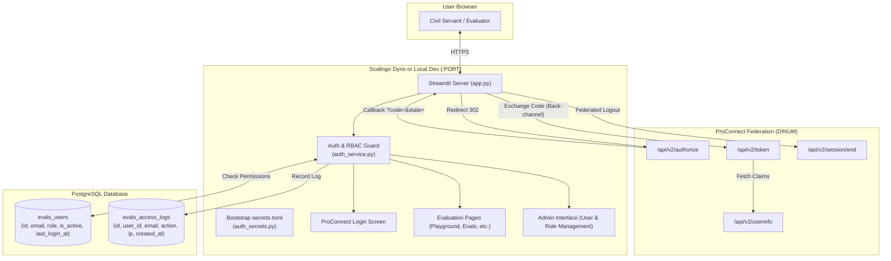

# OpenID Connect (ProConnect) Authentication & RBAC

This document outlines the strong identity authentication and Role-Based Access Control (RBAC) architecture for the Document IA Evaluation Console (`document-ia-evals`).

---

## 1. Context & Motivation

Historically, access to the evaluation console was restricted using IP whitelisting configured via a lightweight Caddy reverse proxy that was downloaded at container startup on Scalingo.

### Limitations of IP Whitelisting
1. **Operational overhead**: Dynamic residential IPs, remote work, coworking spaces, and mobile tethering forced team members to update Scalingo environment variables (`ALLOWED_IPS_ENV`) and reboot containers frequently.
2. **Security vulnerabilities**: Relying solely on `X-Forwarded-For` headers risks header spoofing if not sanitized by upstream gateways. Moreover, authorized IP networks (e.g. ministerial offices or incubators) do not authenticate specific individuals.
3. **No accountability / audit trail**: Inability to identify which team member triggered evaluation runs, altered dataset configurations, or exported confidential test payloads.

### Solution
Replace the network-level filter with **OpenID Connect (OIDC)** authentication through **ProConnect** (the French State's federated identity provider for public sector agents), coupled with database-backed **RBAC** and user audit logging.

---

## 2. Target Architecture



---

## 3. ProConnect Technical Specifications

The integration adheres strictly to the official [ProConnect Partner Documentation](https://partenaires.proconnect.gouv.fr/docs/fournisseur-service/implementation_technique).

### 3.1. Identity Provider Domains
All ProConnect routes start with `/api/v2/`:
- **Integration / Staging (Internet)**: `fca.integ01.dev-agentconnect.fr`
  - Discovery: `https://fca.integ01.dev-agentconnect.fr/api/v2/.well-known/openid-configuration`
- **Production (Internet)**: `auth.agentconnect.gouv.fr`
  - Discovery: `https://auth.agentconnect.gouv.fr/api/v2/.well-known/openid-configuration`

### 3.2. Authorization Request Hygiene
> [!CAUTION]
> ProConnect returns an error `Y000400 : Bad Request Exception` if unexpected query parameters are submitted.
> Only the following standard parameters are transmitted:
> - `response_type=code`
> - `client_id=<CLIENT_ID>`
> - `redirect_uri=<REDIRECT_URI>` (case-sensitive, trailing slash must match exactly)
> - `scope=openid email profile`
> - `state` (minimum 32 random characters for CSRF prevention)
> - `nonce` (minimum 32 random characters for replay prevention)

### 3.3. Token Exchange & Session Expiration
1. **Authorization Code**: Expires after **60 seconds**. Exchanged via `POST /api/v2/token` (`application/x-www-form-urlencoded`).
2. **Access Token**: Valid for **1 hour**.
3. **ID Token**: Signed JWT verified against the `nonce` stored in the session.
4. **Federated Logout**: Redirects the agent's browser to `GET /api/v2/session/end?id_token_hint=<id_token>&state=<state>&post_logout_redirect_uri=<url>`.

### 3.4. UserInfo Retrieval (DINUM Privacy Model)
> [!IMPORTANT]
> In accordance with the DINUM specification, ProConnect's `id_token` is intentionally minimal (`sub`, `aud`, `iss`, `acr`, `amr`, `nonce`) and **contains no personal identifiable information (PII)** such as email or names.
>
> To obtain the civil servant's verified email and identity:
> 1. The server performs a back-channel request to `GET /api/v2/userinfo` with header `Authorization: Bearer <access_token>`.
> 2. Both `application/json` and signed `application/jwt` responses are parsed.
> 3. The resulting claims (`email`, `given_name`, `usual_name`, `siret`) are merged into the session credentials.

---

## 4. Database Schema & RBAC

The database layer uses PostgreSQL managed via Alembic (`alembic/versions/003_add_evals_users_and_access_logs.py`).

### 4.1. Tables

#### `evals_users`
Stores authorized agents and their assigned platform privileges:
- `id` (UUID, Primary Key)
- `email` (VARCHAR(255), Unique, Indexed)
- `role` (VARCHAR(50), `admin` or `user`)
- `is_active` (BOOLEAN, default `true`)
- `created_at` (TIMESTAMP WITH TIME ZONE)
- `updated_at` (TIMESTAMP WITH TIME ZONE)
- `last_login_at` (TIMESTAMP WITH TIME ZONE, nullable)

#### `evals_access_logs`
Audit log recording every authentication lifecycle event:
- `id` (UUID, Primary Key)
- `user_id` (UUID, Foreign Key to `evals_users.id`, ondelete `SET NULL`)
- `email` (VARCHAR(255), Indexed)
- `action` (VARCHAR(100): `login_success`, `access_denied_unknown_user`, `access_denied_disabled_user`, `logout`)
- `ip_address` (VARCHAR(45), nullable)
- `user_agent` (TEXT, nullable)
- `created_at` (TIMESTAMP WITH TIME ZONE, Indexed)

---

## 5. Configuration & Environment Variables

Add the following variables to `.env` (for local development) or to Scalingo Application Environment:

| Variable | Description | Default / Example |
| :--- | :--- | :--- |
| `PROCONNECT_CLIENT_ID` | Client ID assigned by DINUM / ProConnect | `""` |
| `PROCONNECT_CLIENT_SECRET` | Client Secret assigned by DINUM / ProConnect | `""` |
| `PROCONNECT_METADATA_URL` | OpenID Connect Discovery URL | `https://fca.integ01.dev-agentconnect.fr/api/v2/.well-known/openid-configuration` |
| `PROCONNECT_REDIRECT_URI` | Callback endpoint registered on ProConnect | `http://localhost:8501/oauth2callback` (Local) / `https://<domain>/oauth2callback` (Scalingo) |
| `PROCONNECT_COOKIE_SECRET` | 32-byte secret for session cookie encryption | Generated randomly if omitted |
| `PROCONNECT_SCOPES` | Scopes requested during OIDC dance | `openid email profile` |
| `AUTH_BYPASS_LOCAL` | Offline development fallback mode | `false` |

### 5.1. Runtime Bootstrap (`auth_secrets.py`)
Streamlit reads secrets from `.streamlit/secrets.toml`. To comply with 12-factor application design, `document_ia_evals.utils.auth_secrets` runs automatically at startup to sync environment variables into `.streamlit/secrets.toml`.

---

## 6. Testing Environments & Staging Validation

### 6.1. Testing with ProConnect Sandbox
1. Configure `.env` with Sandbox credentials and set `AUTH_BYPASS_LOCAL=false`.
2. Launch the application: `streamlit run src/document_ia_evals/app.py`.
3. Click **"S'identifier avec ProConnect"**.
4. On the ProConnect portal:
   - Use any test account ending in `@test.proconnect.gouv.fr` (e.g. `marie.durand@test.proconnect.gouv.fr`).
   - Or use `user@yopmail.com` (password: `user@yopmail.com`) to simulate a DINUM agent.
5. The agent is redirected back to `http://localhost:8501/oauth2callback`. If enrolled in `evals_users`, full access is granted.

### 6.2. Offline Local Bypass (`AUTH_BYPASS_LOCAL=true`)
When working without network connectivity or outside ProConnect Sandbox availability, set:
```bash
AUTH_BYPASS_LOCAL=true
```
The application will automatically inject an authenticated administrator session (`nicolas.sagon@beta.gouv.fr`) without contacting external identity servers.

---

## 7. User Administration Interface

Administrators can navigate to the **Administration** page (`pages/administration.py`) and access the dedicated tab:
- **👥 Utilisateurs & Droits Evals**:
  - Add new civil servants by email and assign initial roles (`admin` or `user`).
  - Toggle user status (Activate / Deactivate without deleting history).
  - Promote or demote user roles.
  - Review recent connection and access attempts in real-time from `evals_access_logs`.
