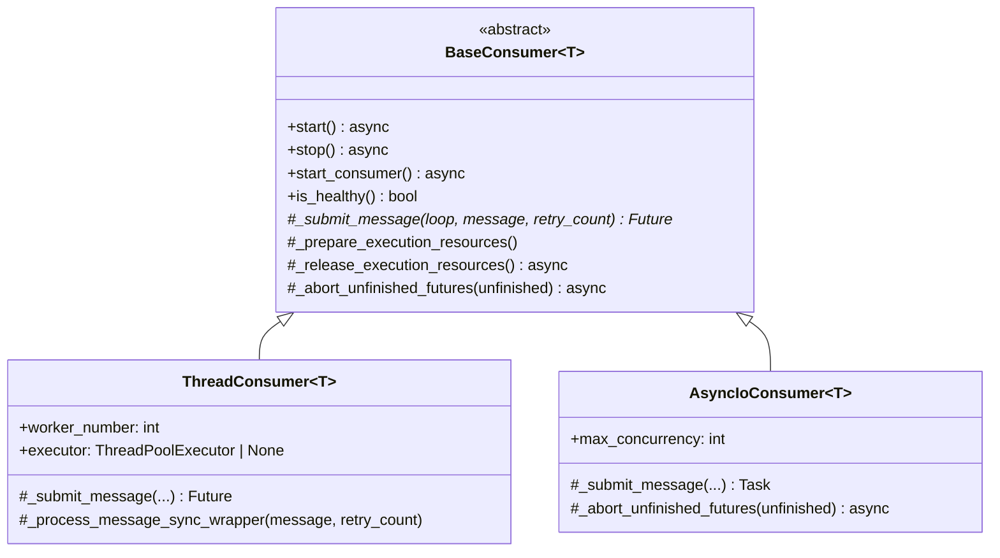
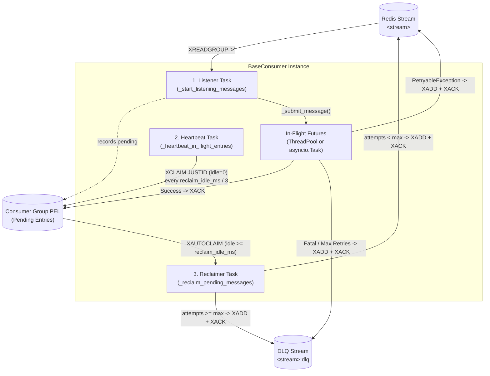

# Redis Stream Consumer (`BaseConsumer`, `ThreadConsumer`, `AsyncIoConsumer`)

Shared Redis Stream consumer implementation split across [`src/document_ia_infra/redis/base_consumer.py`](../src/document_ia_infra/redis/base_consumer.py), [`src/document_ia_infra/redis/thread_consumer.py`](../src/document_ia_infra/redis/thread_consumer.py), and [`src/document_ia_infra/redis/asyncio_consumer.py`](../src/document_ia_infra/redis/asyncio_consumer.py) (re-exported through [`src/document_ia_infra/redis/consumer.py`](../src/document_ia_infra/redis/consumer.py)), used by both `document-ia-api` (webhook delivery) and `document-ia-worker` (document workflow execution).

## Table of Contents

- [Overview](#overview)
- [Class Hierarchy & Execution Modes](#class-hierarchy--execution-modes)
- [Consumer Identity & Group Initialization](#consumer-identity--group-initialization)
- [Runtime Architecture (3 Background Tasks)](#runtime-architecture-3-background-tasks)
- [Message Contract, Retries & DLQ](#message-contract-retries--dlq)
- [Idempotency & Fail-Closed Guarantees](#idempotency--fail-closed-guarantees)
- [Lifecycles & Graceful Shutdown](#lifecycles--graceful-shutdown)
- [Configuration Reference](#configuration-reference)
- [Usage Examples](#usage-examples)

---

## Overview

Redis Streams consumer groups (`XREADGROUP ... >`) deliver new entries to a specific consumer and record them in the **Pending Entries List (PEL)** until acknowledged with `XACK`. If a process crashes, gets `SIGKILL`ed (e.g., OOM), or loses connectivity before `XACK`, those entries stay stuck in the dead consumer's PEL forever unless actively reclaimed.

The `document-ia-infra` consumer hierarchy provides **at-least-once** delivery with:

1. **Per-instance identity** (`build_instance_consumer_name`) so every container/process restart is distinguishable in `XINFO CONSUMERS`.
2. **Bounded concurrency & backpressure** so consumers never read more messages from Redis than they can process concurrently.
3. **In-flight heartbeat** (`XCLAIM ... JUSTID`) so slow but healthy handlers are never mistaken for dead consumers.
4. **Automatic PEL crash recovery** (`XAUTOCLAIM`) reclaiming abandoned entries after `reclaim_idle_ms` (5 minutes by default).
5. **Bounded retries & multi-hop lineage** (`retries`, `original_id`, `root_id`, `original_timestamp`).
6. **Idempotent, fail-closed Dead Letter Queue (`<stream>:dlq`)** and stream size capping (`MAXLEN ~`).

---

## Class Hierarchy & Execution Modes

All Redis Stream protocol logic (~95% of the implementation) lives in the abstract base class `BaseConsumer[T]`. Two concrete subclasses specialize how handlers are scheduled:



### Choosing Between `ThreadConsumer` and `AsyncIoConsumer`

| Aspect | `ThreadConsumer[T]` | `AsyncIoConsumer[T]` |
|---|---|---|
| **Target workload** | CPU/RAM-heavy or hybrid sync/async workflows (`document-ia-worker`: PDF rendering, OpenCV, PyTorch, OCR) | Pure async I/O handlers (`document-ia-api`: PostgreSQL + `httpx` webhook notifications) |
| **Scheduling model** | Lazily initialized `ThreadPoolExecutor` (`loop.run_in_executor`), **one fresh `asyncio` event loop per thread** | `asyncio.create_task` directly on the caller's running event loop (shares host DB/HTTP pools) |
| **Concurrency parameter** | `worker_number` (defaults to `REDIS_WORKER_NUMBER`, i.e., `1`) | `max_concurrency` (defaults to `batch_size`; no `worker_number` or thread pool) |
| **Default `start_from`** | `"0-0"` (do not miss events published before initial group creation) | `"0-0"` (do not miss events published before initial group creation) |
| **Default `close_redis_on_stop`** | `True` (dedicated worker process) | `False` (preserves shared FastAPI `redis_manager`) |
| **Typical lifecycle** | Blocking `await consumer.start_consumer()` | Non-blocking `await consumer.start()` / `await consumer.stop()` |

> [!IMPORTANT]
> In `ThreadConsumer`, each message runs inside its own worker thread with a dedicated `asyncio.new_event_loop()`. Async clients bound to an event loop (such as SQLAlchemy `AsyncEngine`/`AsyncSession` or `redis.asyncio.Redis`) **must not** be shared across threads from the main event loop. In `AsyncIoConsumer`, everything runs on the main event loop, so shared async connection pools work natively.

### Template Method Hooks in `BaseConsumer`

Subclasses customize execution through four internal hooks:

- `_submit_message(loop, message_data, retry_count) -> asyncio.Future`: schedules a decoded message and returns an awaitable `Future`/`Task` tracked by the listener loop.
- `_prepare_execution_resources()` / `_release_execution_resources()`: lifecycle hooks called on startup and shutdown (`ThreadConsumer` initializes and shuts down its `ThreadPoolExecutor` via `asyncio.to_thread`; no-ops in `AsyncIoConsumer`).
- `_abort_unfinished_futures(unfinished)`: called when exiting the listener loop if in-flight futures did not finish within `drain_timeout_s`. `AsyncIoConsumer` cancels unfinished `asyncio.Task`s and awaits their cleanup so no orphan tasks continue running after host resources close; `ThreadConsumer` leaves OS threads to finish during `executor.shutdown(wait=True)`.

---

## Consumer Identity & Group Initialization

### Per-Instance Consumer Name

```python
consumer_name = build_instance_consumer_name("api-webhook-consumer")
# -> "api-webhook-consumer-web-1-1-a3f91c02"
```

`build_instance_consumer_name(base_name)` formats `<base_name>-<sanitized_hostname>-<pid>-<boot_id>`, where `_PROCESS_BOOT_ID` is a random 8-hex-char token generated once at process startup. Including `boot_id` guarantees a fresh consumer identity even in containerized environments (Docker, Kubernetes, Scalingo) where every restarted container gets `PID 1` and potentially the same hostname.

### Consumer Group Creation & Self-Healing

- On startup, `_ensure_consumer_group` executes `XGROUP CREATE <stream> <group> <start_from> MKSTREAM` and ignores `BUSYGROUP` if the group already exists.
- If Redis is temporarily unreachable when `start()` runs, `_needs_group_init` is set and the background tasks automatically initialize the group as soon as connectivity returns.
- If the stream or group is deleted at runtime (`NOGROUP` error during `XREADGROUP` or `XAUTOCLAIM`), both the listener and reclaimer automatically recreate the group without crashing.

---

## Runtime Architecture (3 Background Tasks)

A running consumer coordinates three concurrent `asyncio` tasks over shared sets `_in_flight_ids` and `_reclaiming_ids`:



### 1. Listener Task (`_start_listening_messages`)

On each iteration:
1. **Reaps completed futures**: calls `_handle_finished_future` to `XACK`, re-queue, or route to DLQ, then removes `msg_id` from `_in_flight_ids`.
2. **Applies backpressure**: computes `free_slots = max_in_flight - len(active_futures)`.
   - If `free_slots <= 0`, it does **not** call `XREADGROUP`; instead it awaits `asyncio.wait(..., return_when=FIRST_COMPLETED)`.
   - Otherwise it reads at most `read_count = min(batch_size, free_slots)` messages.
3. **Uses adaptive blocking**: when `active_futures` is non-empty, `XREADGROUP` blocks for `min(200, block_time)` ms instead of the full `block_time` (e.g., 2000–5000 ms) so completed futures are `XACK`ed promptly.
4. **Registers in-flight IDs immediately**: every delivered entry ID is added to `_in_flight_ids` synchronously before the next `await`, ensuring the heartbeat protects it right away.

### 2. Heartbeat Task (`_heartbeat_in_flight_entries`)

Long-running workflows (e.g., multi-page OCR + LLM extraction) or slow webhook retries can legitimately take longer than `reclaim_idle_ms` without being dead.

- Runs every `max(reclaim_idle_ms / 3, 10)` ms (100 seconds by default when `reclaim_idle_ms = 300_000`).
- Calls `XCLAIM <stream> <group> <consumer> 0 <ids...> JUSTID` on `_in_flight_ids | _reclaiming_ids`.
- `JUSTID` resets the idle timer in Redis without transferring message payloads or incrementing the PEL delivery counter.
- Continues running during graceful shutdown until both the listener and reclaimer have completely finished draining (`_worker_tasks_done()`).

### 3. PEL Reclaimer Task (`_reclaim_pending_messages`)

Recovers entries left in the PEL by crashed or restarted consumers:

- Polls `XAUTOCLAIM <stream> <group> <consumer> <reclaim_idle_ms> <cursor> COUNT <reclaim_batch_size>` every `reclaim_poll_interval_s` (1.0 s by default).
- Adds claimed IDs to `_reclaiming_ids` while processing them so the heartbeat prevents another instance from stealing them mid-reclaim.
- Each reclaim counts as **one consumed attempt** (`attempts = retries + 1`):
  - If `attempts < max_retry_number`: copies the entry back onto `<stream>` with `retries = attempts` (via `XADD`) so any healthy consumer can pick it up via `XREADGROUP >`, then `XACK`s the old PEL entry.
  - If `attempts >= max_retry_number`: retains the entry in `<stream>:dlq` with `reason="max_retries_exceeded"`, then `XACK`s the old PEL entry.

---

## Message Contract, Retries & DLQ

### Handler Signature

```python
async def process_message(
    message: T,          # Decoded SerializableMessage subclass instance
    retry_count: int,    # 0 on initial attempt, 1 on first retry, ...
    is_last_retry: bool, # True when retry_count >= max_retry_number - 1
) -> None: ...
```

`max_retry_number` (default `3`, must be `>= 1`) is the **total number of allowed attempts**. With `max_retry_number = 3`, a message runs with `(retry_count=0, is_last_retry=False)`, `(retry_count=1, is_last_retry=False)`, and `(retry_count=2, is_last_retry=True)`.

### Outcome Matrix

| Handler / Decode Outcome | Condition | Stream Action | DLQ `reason` | `XACK` Sent? |
|---|---|---|---|---|
| Normal return | — | None | — | Yes |
| `RetryableException` | `retry_count < max_retry_number - 1` | Re-queued via `XADD` (`retries = retry_count + 1`) | `error_requeueing_message` *(only if `XADD` fails)* | Yes *(after `XADD` or DLQ)* |
| `RetryableException` | `retry_count >= max_retry_number - 1` | Routed to `<stream>:dlq` | `max_retries_exceeded` | Yes *(only if DLQ confirmed)* |
| Any other `Exception` | Immediate | Routed to `<stream>:dlq` | `not_retryable_error` | Yes *(only if DLQ confirmed)* |
| Invalid JSON / missing `data` / bad `retries` | Before handler | Routed to `<stream>:dlq` | `decode_error` | Yes *(only if DLQ confirmed)* |
| `asyncio.CancelledError` | Shutdown / task cancel | **None** | — | **No** (stays in PEL for reclaim) |

### Stream & DLQ Entry Fields (Multi-Hop Lineage)

When a message is re-queued across multiple retries or reclaims, its stream ID changes on every `XADD`. The consumer preserves full lineage metadata:

| Field | On `<stream>` (re-queued) | On `<stream>:dlq` | Description |
|---|---|---|---|
| `data` | Yes | Yes | JSON-serialized `SerializableMessage` payload |
| `retries` | Yes | Yes | Attempts consumed so far (`"1"`, `"2"`, ...) |
| `original_id` | Yes | Yes | Stream ID of the **immediately preceding** hop (used for per-hop deduplication) |
| `root_id` | Yes | Yes | Stream ID of the **very first** published message across all hops |
| `original_timestamp` | If `timestamp` was set | If `timestamp` was set | Timestamp of the very first message |
| `reason` | No | Yes | `decode_error`, `not_retryable_error`, `max_retries_exceeded`, or `error_requeueing_message` |
| `error` | No | Yes | Stringified exception / error details |
| `consumer` | No | Yes | `consumer_name` of the instance that wrote the DLQ entry |
| `timestamp` | Preserved if present | Yes | UTC ISO-8601 timestamp when written to DLQ |

Both `<stream>` re-queues and `<stream>:dlq` writes apply approximate trimming (`XADD ... MAXLEN ~ <maxlen>`) controlled by `stream_maxlen` (`EVENT_STREAM_MAXLEN`) and `dlq_maxlen` (`DLQ_STREAM_MAXLEN`).

---

## Idempotency & Fail-Closed Guarantees

Because Redis Streams require two commands to move a PEL entry (`XADD` to stream/DLQ followed by `XACK`), a network drop or crash right between `XADD` and `XACK` leaves the entry pending in the PEL even though its copy or DLQ record was already written.

To prevent duplicate re-queues or duplicate DLQ entries when that PEL entry is later retried or reclaimed:

1. **DLQ deduplication (`_already_retained_in_dlq`)**:
   - Before writing to `<stream>:dlq`, scans `XRANGE <stream>:dlq <source_ms>-0 + COUNT 200` (starting at the millisecond prefix of `msg_id`, since a DLQ entry is never created before its source message) and checks `entry["original_id"] == msg_id`.
   - If already present, skips the duplicate `XADD` and proceeds directly to `XACK`.
2. **Reclaim re-queue deduplication (`_already_requeued`)**:
   - During `_reclaim_entry`, before copying a reclaimed message onto `<stream>`, scans `XRANGE <stream> (<msg_id> + COUNT 200` (strictly after `msg_id`) for `entry["original_id"] == msg_id`.
   - If already re-queued before a prior `XACK` failure, skips `XADD` and only retries `XACK`.
   - *(Note: the normal hot retry path in `_handle_finished_future` skips `_already_requeued` because a live in-memory future executes once; deduplication is only needed on the cold PEL recovery path.)*
3. **Fail-closed ordering**:
   - `XACK` is **never** called unless processing succeeded, re-queue `XADD` succeeded, or DLQ retention returned `True`.
   - If an `XRANGE` deduplication scan fails (e.g., Redis timeout), the error propagates and the consumer neither writes a potential duplicate nor `XACK`s the PEL entry; it will be safely retried on a subsequent cycle.

---

## Lifecycles & Graceful Shutdown

`BaseConsumer` exposes two lifecycle entry points depending on the host application:

### 1. Non-Blocking Background Lifecycle (`start()` / `stop()`)

Designed for embedded ASGI applications such as `document-ia-api` (FastAPI `lifespan`):

- `await consumer.start()` spawns `listener_task`, `reclaimer_task`, and `heartbeat_task` in the background and returns immediately.
- `consumer.is_healthy()` returns `True` when `stop_flag` is clear and all three tasks are alive (suitable for `/health` probes).
- `await consumer.stop()` sets `stop_flag`, waits up to `(block_time / 1000) + drain_timeout_s + 5s` for the listener and reclaimer to drain while keeping the heartbeat alive, stops the heartbeat, releases execution resources, and closes Redis only if `close_redis_on_stop=True`.

### 2. Blocking Standalone Lifecycle (`start_consumer()`)

Designed for dedicated worker processes such as `document-ia-worker`:

- `await consumer.start_consumer()` initializes Redis and the consumer group (raising `ConnectionError` on startup failure), launches the heartbeat task, and runs the listener and reclaimer inside an `asyncio.TaskGroup`.
- Signal handlers (`SIGINT` / `SIGTERM`) trigger graceful shutdown simply by setting `consumer.stop_flag.set()` and awaiting the main task.

### Shutdown Drain Sequence

When `stop_flag` is set:
1. `_start_listening_messages` stops reading new batches and waits up to `drain_timeout_s` (10 s default) for `active_futures` to finish while `_heartbeat_in_flight_entries` continues refreshing their PEL timers.
2. Any futures that completed during the drain are finalized (`XACK` / retry / DLQ) under `asyncio.shield(...)` so even an external task cancellation cannot drop completed work.
3. Any futures still unfinished after `drain_timeout_s` are passed to `_abort_unfinished_futures` (cancelled in `AsyncIoConsumer`, raising `CancelledError` -> **left unacknowledged in PEL** so another instance reclaims them cleanly).

---

## Configuration Reference

### Environment Variables (`RedisSettings`)

Defined in [`src/document_ia_infra/redis/redis_settings.py`](../src/document_ia_infra/redis/redis_settings.py):

| Variable | Default | Description |
|---|---|---|
| `REDIS_URL` | `None` | Full Redis connection URL (overrides host/port/db/password when set) |
| `REDIS_HOST` / `REDIS_PORT` / `REDIS_DB` / `REDIS_PASSWORD` | `localhost` / `6379` / `0` / `password` | Individual Redis connection settings |
| `REDIS_WORKER_NUMBER` | `1` | Default `worker_number` for `ThreadConsumer` |
| `EVENT_STREAM_NAME` | `"event_stream"` | Stream name for workflow execution events |
| `EVENT_CONSUMER_GROUP` | `"workflow_execution_consumer"` | Consumer group for workflow workers |
| `WEBHOOK_STREAM_NAME` | `"webhook_stream"` | Stream name for webhook notifications |
| `WEBHOOK_CONSUMER_GROUP` | `"webhook_consumer"` | Consumer group for API webhook consumers |
| `EVENT_STREAM_MAXLEN` | `100000` | Default approximate `MAXLEN` when re-queuing messages |
| `DLQ_STREAM_MAXLEN` | `100000` | Default approximate `MAXLEN` for `<stream>:dlq` streams |

### Constructor Parameters

| Parameter | Subclass | Default | Description |
|---|---|---|---|
| `consumer_name` | Both | *(required)* | Unique consumer identity (use `build_instance_consumer_name(...)`) |
| `consumer_group` | Both | *(required)* | Redis Stream consumer group name |
| `stream_name` | Both | *(required)* | Source Redis Stream name (DLQ is `<stream_name>:dlq`) |
| `batch_size` | Both | *(required)* | Max entries fetched per `XREADGROUP` call (`>= 1`) |
| `block_time` | Both | *(required)* | `XREADGROUP` block timeout in milliseconds when idle |
| `message_class` | Both | *(required)* | `SerializableMessage` subclass used to decode `fields["data"]` |
| `process_message_callable` | Both | *(required)* | Async handler `(message: T, retry_count: int, is_last_retry: bool) -> None` |
| `worker_number` | `ThreadConsumer` | `REDIS_WORKER_NUMBER` | ThreadPool size and `max_in_flight` limit (`>= 1`) |
| `max_concurrency` | `AsyncIoConsumer` | `None` (`= batch_size`) | Max concurrent `asyncio.Task`s in flight (`>= 1`) |
| `max_retry_number` | Both | `3` | Total allowed attempts before routing to DLQ (`>= 1`) |
| `start_from` | `ThreadConsumer` / `AsyncIoConsumer` | `"0-0"` | Initial cursor when creating a missing consumer group |
| `reclaim_idle_ms` | Both | `300000` (5 min) | Minimum PEL idle time in ms before `XAUTOCLAIM` reclaims an entry |
| `reclaim_batch_size` | Both | `batch_size` | `COUNT` passed to `XAUTOCLAIM` |
| `reclaim_poll_interval_s` | Both | `1.0` | Delay in seconds between `XAUTOCLAIM` sweeps |
| `drain_timeout_s` | Both | `10.0` | Grace period in seconds for in-flight tasks on `stop()` |
| `stream_maxlen` | Both | `EVENT_STREAM_MAXLEN` | Approximate `MAXLEN` for re-queued entries (`None` disables trimming) |
| `dlq_maxlen` | Both | `DLQ_STREAM_MAXLEN` | Approximate `MAXLEN` for DLQ entries (`None` disables trimming) |
| `close_redis_on_stop` | `ThreadConsumer` / `AsyncIoConsumer` | `True` / `False` | Whether stopping the consumer closes the `RedisManager` connection |
| `current_redis_manager` | Both | `None` | Optional custom `RedisManager` (defaults to global `redis_manager`) |

---

## Usage Examples

### 1. I/O-Bound FastAPI Background Consumer (`AsyncIoConsumer`)

Used in `document-ia-api` (`lifespan`) to deliver webhook HTTP notifications concurrently on the main event loop:

```python
from contextlib import asynccontextmanager
from fastapi import FastAPI
from document_ia_infra.redis.consumer import (
    AsyncIoConsumer,
    build_instance_consumer_name,
)
from document_ia_infra.redis.model.webhook_message import WebHookMessage
from document_ia_infra.redis.redis_settings import redis_settings


@asynccontextmanager
async def lifespan(app: FastAPI):
    consumer = AsyncIoConsumer[WebHookMessage](
        consumer_name=build_instance_consumer_name("api-webhook-consumer"),
        consumer_group=redis_settings.WEBHOOK_CONSUMER_GROUP,
        stream_name=redis_settings.WEBHOOK_STREAM_NAME,
        batch_size=50,
        block_time=2000,
        message_class=WebHookMessage,
        process_message_callable=webhook_service.process_webhook_notification,
        max_retry_number=3,
    )
    await consumer.start()
    try:
        yield
    finally:
        await consumer.stop()
```

### 2. CPU-Bound Standalone Worker (`ThreadConsumer`)

Used in `document-ia-worker` to execute document workflows in a `ThreadPoolExecutor` with graceful `SIGINT`/`SIGTERM` draining:

```python
import asyncio
import signal
from document_ia_infra.redis.consumer import (
    ThreadConsumer,
    build_instance_consumer_name,
)
from document_ia_infra.redis.model.workflow_execution_message import (
    WorkflowExecutionMessage,
)
from document_ia_infra.redis.redis_settings import redis_settings


async def main() -> None:
    consumer = ThreadConsumer[WorkflowExecutionMessage](
        consumer_name=build_instance_consumer_name("worker"),
        consumer_group=redis_settings.EVENT_CONSUMER_GROUP,
        stream_name=redis_settings.EVENT_STREAM_NAME,
        batch_size=1,
        block_time=5000,
        message_class=WorkflowExecutionMessage,
        process_message_callable=process_workflow_execution,
        worker_number=redis_settings.REDIS_WORKER_NUMBER,
        max_retry_number=3,
    )

    loop = asyncio.get_running_loop()
    for sig in (signal.SIGINT, signal.SIGTERM):
        loop.add_signal_handler(sig, consumer.stop_flag.set)

    await consumer.start_consumer()
```
