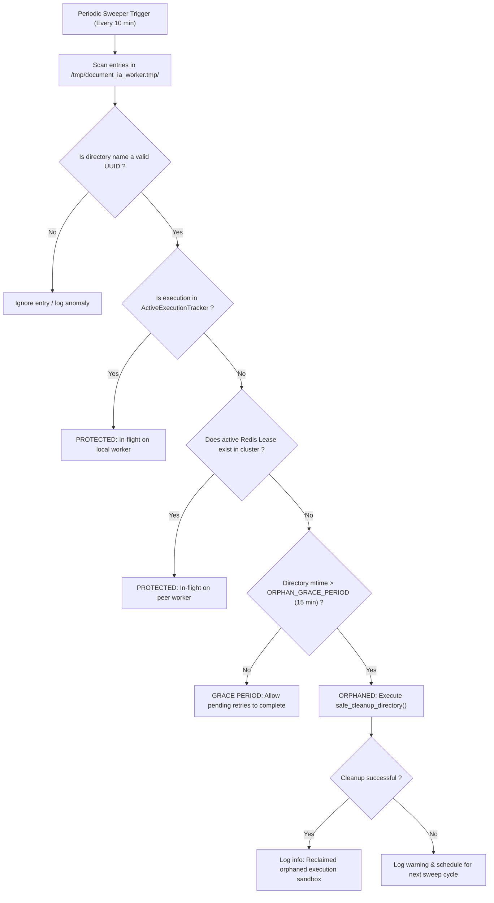

# Security Architecture: Temporary Files Confinement & Incident Cleanup

**Initiative**: #151 - Security Hardening
**Tracking Plan**: S7 | **Priority**: P1
**Associated Design Decision**: D2
**GitHub Reference**: `Closes #158`

---

## 1. Executive Summary

Document IA workers handle sensitive user documents (such as official French ID documents, payslips, and tax notices) downloaded from AWS S3, local storage, or remote HTTP endpoints. During workflow execution, intermediate files are unpacked, converted (e.g. PDF rendered to high-resolution PNGs at 200/300 DPI), and processed by OCR and computer vision models.

This document formalizes the architecture, permission model, and lifecycle governance of temporary files and directories:
1. **Strict Confinement & Permissions (`0700`/`0600`)**: Isolation of working directories to the worker process user only.
2. **Active vs Abandoned Qualification**: A multi-tiered algorithm ensuring that in-flight jobs (locally or cluster-wide) are never disturbed while orphaned directories resulting from unhandled crashes (e.g. Linux Kernel OOM `SIGKILL`, abrupt host restarts) or watchdog timeouts are safely reclaimed.
3. **Automated Background Sweeper (`TempFileSweeper`)**: Continuous periodic reconciliation running every 10 minutes, suited to Scalingo ephemeral container disks.
4. **LLM/OCR Replay Retention Policy**: Restricting replay dumps to private permissions with an automated 24-hour expiration window.
5. **Architectural Boundary (Decision D2)**: Explicit separation between application-level logical deletion and host-level physical volume destruction.

---

## 2. Threat Model & Mitigations

| Threat Vector | OWASP Ref | Vulnerability Mechanism | Implemented Defense |
| :--- | :--- | :--- | :--- |
| **Information Disclosure via Shared `/tmp`** | A01:2021 | Default umask (`0022` or `0002`) creates world- or group-readable temporary directories (`0755` / `0777`). Local untrusted processes can inspect extracted documents. | Explicit permission enforcement: sandbox root and execution directories are created with `0o700` (`rwx------`); generated files are opened with `0o600` (`rw-------`). |
| **Sandbox Inode Accumulation (Disk DoS)** | A04:2021 | Unhandled exceptions, watchdog fencing, or hard process termination (`SIGKILL`) leave orphaned files in `/tmp/document_ia_worker.tmp/`, eventually exhausting disk space or inodes. | Background `TempFileSweeper` sweeps directories older than `ORPHAN_DIR_GRACE_PERIOD_S` (15 min) with no active local handler and no active Redis lease. |
| **Premature Deletion of Retried Tasks** | A04:2021 | A naive startup cleaner or aggressive sweeper deletes files of a workflow currently executing or scheduled for an immediate retry. | In-flight tracking via `ActiveExecutionTracker` and distributed Redis lease checks (`StreamDelivery.execution_lease_key`) prevent deletion of active workflows. |
| **Model Cache Confusion / Tampering** | A01:2021 | A sweeper blindly deleting under `/tmp` or root inadvertently purges YOLO-World or QRDet model weights (`.models/`, `~/.cache`), forcing re-downloads or breaking offline container boot. | Sweeper is strictly confined to `DEFAULT_SANDBOX_BASE` and `OPENAI_REPLAY_PAYLOAD_SAVE_PATH`. Subdirectories must strictly match standard UUID patterns; non-UUID entries are ignored. |
| **Replay Payload Leakage** | A01:2021 | Prompts and extracted text saved under `/tmp/document-ia-openai-replay` remain permanently on disk with permissive rights. | Replay feature remains disabled by default (`OPENAI_REPLAY_PAYLOAD_SAVE_ENABLED=False`). When enabled, writes are enforced at `0o700`/`0o600` and pruned after 24 hours. |
| **Cleanup Failure Silent Disregard** | A04:2021 | Transient file locks or `OSError` during step cleanup are ignored, leaving sensitive documents permanently on disk without operator visibility. | Immediate error logging (`WARNING`), failure recording, and deferral to the background sweeper without stalling the worker thread. |

---

## 3. Directory Structure & Permission Matrix

```text
/tmp/
├── document_ia_worker.tmp/                 [Mode: 0700 | Owner: worker]
│   └── <execution_id_uuid4>/              [Mode: 0700 | Owner: worker]
│       ├── <random_token>.tmp             [Mode: 0600 | In-flight download]
│       ├── <random_token>.pdf             [Mode: 0600 | Validated source file]
│       ├── page_1.png                     [Mode: 0600 | Rendered PDF page]
│       └── ..._yoloworld_crop.png         [Mode: 0600 | Cropped image]
└── document-ia-openai-replay/              [Mode: 0700 | Optional, default off]
    └── <execution_id>.json                [Mode: 0600 | Retention: 24h]
```

### Permission Enforcement Rules
1. **Base Sandbox**: Created on demand with `ensure_directory_permissions(DEFAULT_SANDBOX_BASE, 0o700)`.
2. **Execution Sandbox**: Created via `get_execution_sandbox_root(execution_id)` with `ensure_directory_permissions(root, 0o700)`.
3. **File Descriptors**: Opened via `ConfinedDirectory.open_file` with `os.O_CREAT | os.O_WRONLY | _O_NOFOLLOW | _O_CLOEXEC` and mode `0o600`.
4. **Third-party Outputs**: OpenCV (`cv2.imwrite`) and PyMuPDF (`pix.save`) outputs are immediately secured using `ensure_file_permissions(path, 0o600)`.

---

## 4. Lifecycle & Active vs Abandoned Directory Qualification



### The Three Qualification Gates
1. **Local Worker In-Flight Tracker (`ActiveExecutionTracker`)**:
   - Thread-safe registry tracking all `execution_id` currently handled by the local thread pool.
   - Any directory matching an active execution is exempt from cleanup.
2. **Distributed Redis Lease (`StreamDelivery.execution_lease_key`)**:
   - Workflows in a cluster hold a distributed lease key (`lock:workflow_execution:{execution_id}`).
   - If a valid lease is found in Redis, the execution is considered active on another worker.
3. **Grace Period Threshold (`ORPHAN_DIR_GRACE_PERIOD_S = 900`)**:
   - With a maximal workflow processing timeout of 120 seconds, a 15-minute grace period provides a conservative safety margin to absorb transient retries before concluding that a directory is abandoned.

---

## 5. Background Sweeper (`TempFileSweeper`)

### Startup & Scalingo Container Lifecycle
At worker boot, an initial sweep pass (`TempFileSweeper.startup_cleanup()`) re-evaluates all existing temporary directories and expired replay payloads to recover from abrupt host or container crashes.

The primary role of the background cleaner is **in-process lifecycle cleanup**:
- Runs as an asynchronous background task (`asyncio.create_task`) spawned inside `document-ia-worker/main.py`.
- Awakens every 10 minutes (`SWEEP_INTERVAL_S = 600`).
- Performs two passes:
  1. **Sandbox Sweep**: Reclaims abandoned execution sandboxes in `/tmp/document_ia_worker.tmp/`.
  2. **Replay Sweep**: Purges `.json` payloads in `/tmp/document-ia-openai-replay/` older than 24 hours (`OPENAI_REPLAY_RETENTION_HOURS = 24`).
- Handles graceful shutdown via an `asyncio.Event` cancellation token.

---

## 6. Decision D2: Logical Deletion vs Physical Destruction

To address architectural decision **D2** within the #151 Security Initiative, the boundaries of responsibility are defined as follows:

| Layer | Responsibility | Mechanism | Boundary Scope |
| :--- | :--- | :--- | :--- |
| **Application Layer (`document-ia-worker`)** | **Logical Deletion** | Safe recursive descriptor unlink (`_remove_tree_relative`), closing of all file descriptors (`_O_CLOEXEC`), and inode unlinking. Immediate cleanup on terminal completion and periodic orphan sweeping. | Software layer / Worker process runtime. |
| **Infrastructure Layer (Hosting / Cloud)** | **Physical Destruction & Data-at-Rest Protection** | Ephemeral volume shredding upon container termination, cryptographic erasure (destroying ephemeral volume keys in LUKS/cloud hypervisors), and SSD wear-leveling disposal. | Infrastructure layer (addressed in Initiative #151 milestone I3 / Issue #168). |

Document IA guarantees that once a workflow concludes or an orphaned directory exceeds its grace period, all application-level pointers, pathnames, and file descriptors are completely severed and freed from the operating system page cache.
